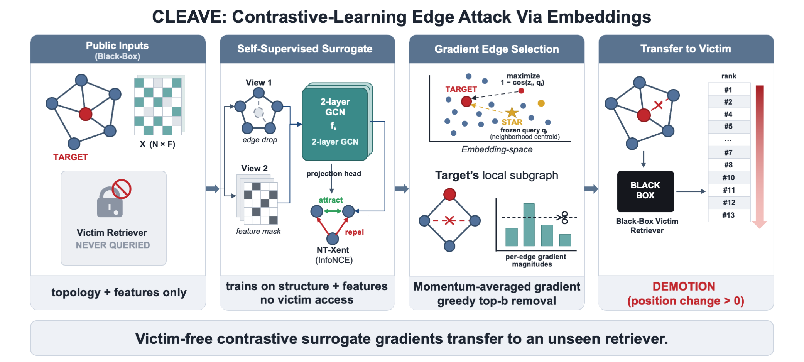

# Contrastive Surrogate Attacks on Graph-Based Retrieval

**Sink any node in a GNN retriever's ranking by cutting a handful of edges, without ever querying the victim.**

[](#license)
[](#installation)

Official implementation of **CLEAVE** (*Contrastive-Learned Edge Attack Via Embeddings*), a **query-free black-box** adversarial **rank-demotion** attack on graph-based retrieval, together with the full evaluation framework: twelve baseline attacks and three unsupervised graph contrastive retrievers (GRACE, GCA, EPAGCL).



## TL;DR

A frozen GNN retriever ranks nodes by embedding similarity. CLEAVE picks up to **b = 1 to 5 undirected edges** incident to a **target node**, removes them, and pushes that node **down** the ranking. It never queries the victim, never sees labels, and never uses oracle information. Instead it trains its **own** self-supervised contrastive GCN surrogate from scratch on nothing but **public graph structure and node features**, then selects edges with a **momentum-averaged gradient** over a differentiable edge mask in the surrogate's embedding space. The chosen removals **transfer** unchanged to the separately trained black-box victim.

Across **27 dataset by victim settings** (nine graphs, three contrastive retrievers), CLEAVE achieves the **largest demotion at budget 5 in 26 of the 27 settings**, and its advantage grows with the edge-removal budget.

> **Metric.** Position change `delta_t = rank_after(t) - rank_before(t)`. **Positive means the node moved down the ranking, i.e. a successful attack.**

## What "CLEAVE" stands for

**C**ontrastive **L**earned **E**dge **A**ttack **V**ia **E**mbeddings. It *cleaves* a node away from its neighborhood in retrieval space.

| Letter | Idea | In the method |
| --- | --- | --- |
| **C** Contrastive | Self-supervised signal | GRACE-style NT-Xent trains the surrogate with no labels |
| **L** Learned | Surrogate from scratch | 2-layer GCN encoder trained on public data only |
| **E** Edge | The perturbation | Remove undirected edges incident to the target |
| **A** Attack | Rank demotion | Push the target down, measured by position change |
| **V** Via | Transfer mechanism | Gradients on the surrogate, applied to the black-box victim |
| **E** Embeddings | The battleground | Loss lives in cosine-embedding space against a frozen centroid query |

## How CLEAVE works

The figure above shows the three stages. Concretely:

1. **Train a surrogate encoder from scratch.** The surrogate is a **two-layer GCN** with a continuous edge mask that gates message passing, trained with a **GRACE-style NT-Xent** contrastive objective on two augmented views (edge dropping and feature masking). It uses only public topology and node features, so no labels, no oracle, and no victim access. Settings shared across datasets: momentum `mu = 0.6`, `Adam(lr = 1e-3)`, temperature `tau = 0.5`, batch size 2048, `T = 1000` gradient steps, and a single surrogate. The surrogate width, training length, edge-drop rates, degree exponent, and query radius are selected **per dataset on a held-out validation split** (see [Per-dataset configuration](#per-dataset-configuration)). The surrogate is trained once per dataset and reused across targets, budgets, and victim retrievers.

2. **Freeze the query.** For each target `t`, a **neighborhood-centroid query** `q_t` is computed once on the clean graph, either the mean of the target's 1-hop neighbor embeddings (`1-hop`) or the mean over the combined 1-hop and 2-hop set excluding the target (`2-hop`). The radius is fixed per dataset and shared by all methods. The frozen `q_t` does not move under perturbation, so demotion is modeled as pushing the target away from its clean retrieval context. If the neighborhood is empty, `q_t` falls back to the target's own clean embedding.

3. **Select edges by momentum-averaged gradient.** Attach a differentiable value to every incident edge and maximize the demotion objective `L = 1 - cos(f(X, w)_t, q_t)`. Starting from the clean graph, at each step CLEAVE backpropagates `L` to per-edge gradients, L1-normalizes them, accumulates momentum `g_bar = mu * g_bar + g / ||g||_1`, then greedily removes the incident edge whose removal is predicted to increase demotion the most. It stops at budget `b` or when no remaining incident edge has a positive demotion score. Optional victim-free refinements (degree-aware reweighting, per-dataset surrogate capacity, and a single-edge rule at budget 1) improve transfer while staying within the query-free constraint.

The recorded removals are applied to the graph and evaluated only on the separately trained victim retriever, so transfer is a genuine empirical property rather than a result of querying the victim.

### Why this is genuinely query-free black-box

* The victim retriever is **never queried** during surrogate training or edge selection.
* No node labels and no target-specific oracle labels are used at attack time.
* The demotion target is the frozen `q_t`, not a victim response.
* The surrogate is trained only on public topology and node features, which are assumed available for the graph.

## Rank-demotion setup

* **Retriever** (GRACE / GCA / EPAGCL): a frozen, pre-trained contrastive GCN encoder that maps each node to an embedding.
* **Retrieval and ranking**: the *query* is a frozen neighborhood-centroid built on the clean graph; the *corpus* is every node's embedding. Nodes are ranked by cosine similarity to the query. `position_change = rank_after - rank_before` (higher means more demoted). See `src/evaluations/retrieval.py`.
* **Attack**: an `Attacker` selects up to `budget` undirected edges incident to the target and removes them; the victim re-embeds the attacked graph and we measure the rank change.
* **Two victim models by design**: attacks are constructed against one model and evaluated against a **separately trained** victim (`best_ac_gcn_attack.pth`), so results measure black-box transfer rather than white-box overfitting.

> **Graph convention:** all bundled datasets are **undirected** (citation, co-purchase, co-authorship). An edge is the undirected pair `{target, neighbor}`, `budget` counts undirected edges, removal drops **both** directed entries, and the loader asserts `is_undirected()`.

## Key results

At **budget 5**, CLEAVE produces the **largest rank demotion in 26 of the 27** dataset by victim settings. The gains are consistent across all three victim retrievers (GRACE, GCA, EPAGCL), even though the attack is built without querying any of them.

* **Budget behavior.** At budget 1 a strong structural or gradient baseline can occasionally match or exceed CLEAVE, because the single best removal is often a structurally prominent edge. As the budget grows, CLEAVE separates from the baselines by selecting complementary removals. For example, at budget 5 on PubMed it reaches 131.09 under EPAGCL (vs. 121.66 for Degree and 117.47 for InfMax), 79.84 under GCA, and 85.42 under GRACE.
* **Per-target behavior.** At budget 5, most targets are demoted, the near-neutral region is small, and promotions are rare. The distribution is heavy-tailed: a few targets move by hundreds of positions, while a long body of targets sees moderate positive demotion, so the average is not driven by a handful of outliers.
* **Efficiency.** Surrogate training is amortized once per dataset, and per-target selection is a handful of sparse forward and backward passes. In the reported comparisons no baseline is simultaneously faster and stronger than CLEAVE.
* **Robustness.** CLEAVE stays above the strongest baseline across surrogate embedding dimensions in {128, 256, 512}, benefits from contrastive augmentation (and is stable across a broad range of nonzero edge-drop rates), and degrades gracefully under partial-graph access.

Full per-dataset numbers and the baseline tables are under `results/`.

## Baselines

CLEAVE is compared against **twelve baselines** spanning the main families of graph attacks, all adapted to the same retrieval setting (target-incident undirected edge removal, same budget, evaluated on the separately trained victim):

| Family | Baselines |
| --- | --- |
| Structural and influence | Random, Degree, PageRank, InfMax, Viking |
| Link-perturbation and black-box | RLP, InfAttack, GraphMI, GraphZoom |
| Gradient-oriented | AGPOA, Nettack, NAG-R |

The gradient baselines use a proxy or surrogate for their gradients, but that proxy is kept separate from the held-out victim, so the comparison is conservative with respect to CLEAVE's stricter access model.

## Repository structure

```
cleave/
├── README.md                     # this file
├── LICENSE                       # Apache-2.0
├── REPRODUCIBILITY.md            # exact commands to reproduce the tables and figures
├── requirements.txt              # torch, torch-geometric, hydra-core, ...
├── build_oracle.py               # optional optimal-removal reference (analysis upper bound)
├── retriever_attack.py           # entry: run attackers on black-box retrievers, writes output/ CSVs
├── conf/                         # Hydra configs
│   ├── config.yaml               # main list: twelve baselines plus CLEAVE (default cell: citeseer, epagcl)
│   ├── config_cleave.yaml        # CLEAVE-only entry point
│   ├── dataset/                  # 9 datasets
│   ├── retriever/                # epagcl.yaml, gca.yaml, grace.yaml
│   ├── attacker/                 # baseline configs plus cleave.yaml (CLEAVE)
│   └── experiment/               # pre-composed attacker bundles
├── src/
│   ├── attackers/
│   │   ├── base.py               # Attacker contract
│   │   ├── degree.py, pagerank.py, random.py, rlp.py, nettack.py, agpoa.py, nag_r.py
│   │   ├── graphmi.py, graphzoom.py, infattack.py, infmax.py, viking.py
│   │   ├── __init__.py           # attacker registry (key "cleave" maps to CLEAVEAttack)
│   │   └── contrib/
│   │       ├── cleave_attack.py  # CLEAVE, class CLEAVEAttack
│   │       └── edges/
│   │           ├── contrastive_surrogate.py  # self-supervised GRACE surrogate (NT-Xent plus augmentations)
│   │           └── contrastive_probe.py      # NT-Xent loss and projection head
│   ├── retrievers/               # EPAGCL / GCA / GRACE encoders plus registry
│   ├── data/                     # PyG loader, train/test target splits
│   ├── evaluations/retrieval.py  # centroid-query ranking, position_change metric
│   └── utils/
├── cache/
│   ├── checkpoints/{epagcl,gca,grace}/<Dataset>/  # victim / reference weights, REGENERATE via training (not shipped)
│   ├── queries/                  # frozen centroid queries (seed 42)
│   └── splits/                   # train/test target splits (seed 42)
├── results/                      # baseline scores and result tables
└── scripts/                      # cleaned reproduction and ablation drivers
```

## Installation

Requires **Python 3.8+**.

```bash
git clone https://github.com/ls3-lab/CLEAVE.git cleave
cd cleave

# Python dependencies
pip install -r requirements.txt
# torch-geometric needs compiled extensions (torch-scatter, torch-sparse, ...)
# matching your Torch/CUDA build. Install those per the PyG docs.
```

**Retriever checkpoints, regenerate (not shipped).** The trained victim and reference weights are **not** bundled. Train them from the deterministic, seeded scripts under `src/retrievers/`, see [Training retrievers](#training-retrievers) and [REPRODUCIBILITY.md](REPRODUCIBILITY.md). CLEAVE itself trains its own surrogate from scratch and needs only the **victim** checkpoint to evaluate an attack.

## Quickstart

```bash
# 1) Run CLEAVE on Amazon-Photo against the EPAGCL victim (budgets 1 to 5)
python retriever_attack.py --config-name config_cleave dataset=amazon_photo retriever=epagcl

# 2) Sweep CLEAVE across all three victim retrievers on Cora
python retriever_attack.py --config-name config_cleave dataset=cora --multirun retriever=epagcl,gca,grace

# 3) Run the full suite (twelve baselines plus CLEAVE) on the default cell (CiteSeer, EPAGCL, b=5)
python retriever_attack.py
```

Results land in `output/<date>/<time>/` as `results_*.csv` with per-attacker timing. Attacks need the victim checkpoint, so train the retrievers first (see Installation).

### Running with Hydra

The entry point is `retriever_attack.py`, configured with [Hydra](https://hydra.cc/). Override any parameter from the CLI:

```bash
python retriever_attack.py dataset=cora retriever=gca general.budget=5 general.seed=123
python retriever_attack.py general.device=cpu
```

| Datasets (`dataset=`) | Retrievers (`retriever=`) |
|---|---|
| `cora`, `citeseer`, `pubmed`, `corafull`, `dblp`, `amazon_photo`, `amazon_computers`, `coauthor_cs`, `coauthor_physics` | `epagcl`, `gca`, `grace` |

## Per-dataset configuration

Everything below is selected once on a held-out validation split of targets that is disjoint from the evaluation targets. During selection the surrogate training subgraph excludes both validation and test targets and their incident edges, so the choice is leakage-free with respect to the test targets and uses no victim signal. `p1` and `p2` are the two contrastive edge-drop rates, `d` is the surrogate dimension, `beta` controls degree-aware reweighting, and `r` is the query radius.

| Dataset | p1 | p2 | epochs | d | beta | r |
|---|---|---|---|---|---|---|
| PubMed | 0.5 | 0.5 | 600 | 512 | 0.0 | 1-hop |
| Amazon-Photo | 0.3 | 0.3 | 300 | 256 | 0.0 | 2-hop |
| Coauthor-CS | 0.4 | 0.4 | 300 | 128 | 0.0 | 1-hop |
| Coauthor-Physics | 0.3 | 0.4 | 300 | 256 | 0.0 | 1-hop |
| CoraFull | 0.3 | 0.4 | 300 | 256 | 0.0 | 2-hop |
| DBLP | 0.3 | 0.4 | 300 | 256 | 1.0 | 1-hop |
| Amazon-Computers | 0.3 | 0.4 | 300 | 256 | 0.0 | 1-hop |
| CiteSeer | 0.3 | 0.4 | 50 | 256 | 0.0 | 2-hop |
| Cora | 0.3 | 0.4 | 50 | 256 | 1.0 | 2-hop |

## Reproducing the paper

All commands to regenerate the tables and figures (budget curves, per-target distributions, efficiency, surrogate-dimension and augmentation sensitivity, partial-graph access) live in [REPRODUCIBILITY.md](REPRODUCIBILITY.md), with the driver scripts under `scripts/`. The baseline scores are under `results/`.

## Training retrievers

```bash
# GCA
cd src/retrievers/GCA/ && python train.py --dataset Cora
# EPAGCL
python src/retrievers/EPAGCL/main.py --dataset Cora
# GRACE
python src/retrievers/GRACE/train.py --dataset Cora
```

Training is seeded for determinism, so retrained weights reproduce the checkpoints used in the paper.

## Datasets and victims

All nine graphs are treated as undirected. Edge counts are undirected and `deg` is the average node degree.

| Dataset | Nodes | Edges | Feat. | Classes | deg |
|---|---|---|---|---|---|
| Cora | 2,708 | 5,278 | 1,433 | 7 | 3.9 |
| CiteSeer | 3,327 | 4,552 | 3,703 | 6 | 2.7 |
| PubMed | 19,717 | 44,324 | 500 | 3 | 4.5 |
| CoraFull | 19,793 | 63,421 | 8,710 | 70 | 6.4 |
| DBLP | 17,716 | 52,867 | 1,639 | 4 | 6.0 |
| Amazon-Computers | 13,752 | 245,861 | 767 | 10 | 35.8 |
| Amazon-Photo | 7,650 | 119,081 | 745 | 8 | 31.1 |
| Coauthor-CS | 18,333 | 81,894 | 6,805 | 15 | 8.9 |
| Coauthor-Physics | 34,493 | 247,962 | 8,415 | 5 | 14.4 |

**Victim retrievers** (frozen, unsupervised graph contrastive encoders): EPAGCL, GCA, GRACE.

## Extending CLEAVE or adding a new attack

Attacks live behind a small contract in `src/attackers/base.py`: implement `score_edges(target_node) -> {(src, dst): float}`; the base `attack()` removes the top-`budget` edges. To add a new method, drop a module under `src/attackers/contrib/` that exposes an `ATTACKERS` dict (or calls `register_attacker` at import), add a `conf/attacker/<name>.yaml` with a matching `name:`, and reference it in `conf/config.yaml`. CLEAVE itself is implemented exactly this way (`src/attackers/contrib/cleave_attack.py`), so it doubles as a worked example.

## Ethics and responsible use

CLEAVE is a research tool for studying the **robustness** of graph-based retrieval. Rank demotion through plausible graph edits can reduce the visibility of papers, products, experts, or accounts, and can be hard to detect because the system keeps returning coherent results. We release this implementation only for reproducible research, controlled robustness assessment, and the development of defenses (for example structural stress testing, monitoring unusual edge removals around high-value entities, provenance tracking for graph edits, and audits of large rank changes after updates). Do not use it against retrieval systems you do not own or have permission to test. All experiments here use public academic graph datasets.

## Citation

If you use CLEAVE or this framework, please cite:

```bibtex
@article{hosseini2026cleave,
  title   = {Contrastive Surrogate Attacks on Graph-Based Retrieval},
  author  = {Hosseini, Seyed Mohammad and Hamidi Rad, Radin and Khosrojerdi, Amir and Zihayat, Morteza and Tang, Jian and Fung, Benjamin C. M. and Bagheri, Ebrahim},
  journal = {IEEE Transactions on Knowledge and Data Engineering},
  year    = {2026},
  note    = {CLEAVE: Contrastive-Learned Edge Attack Via Embeddings},
  doi     = {TODO}
}
```

## License

Released under the **Apache-2.0** license. See [LICENSE](LICENSE) and [NOTICE](NOTICE).
